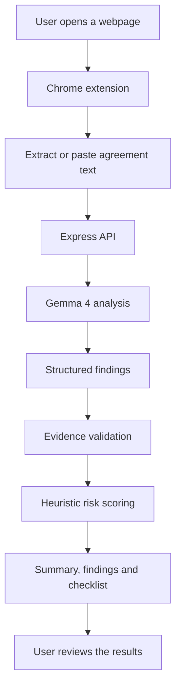

# ClauseWise — Understand Before You Agree

**ClauseWise** is an AI-powered Terms & Conditions risk analysis tool that helps users understand potentially risky clauses before accepting an agreement. It uses Gemma 4 to analyze agreement text and presents a structured review with evidence, risk severity, a heuristic score, and actionable recommendations.

The project combines a Chrome extension with a Node.js and Express backend to make lengthy legal documents easier to review.

> **Disclaimer:** ClauseWise provides AI-assisted information for educational purposes. It does not provide legal advice, and its risk score is a heuristic rather than a legally validated assessment.

## Table of Contents

- [Overview](#overview)
- [Problem Statement](#problem-statement)
- [Key Features](#key-features)
- [How It Works](#how-it-works)
- [Technology Stack](#technology-stack)
- [Project Structure](#project-structure)
- [Prerequisites](#prerequisites)
- [Installation and Setup](#installation-and-setup)
- [Using the Chrome Extension](#using-the-chrome-extension)
- [API Documentation](#api-documentation)
- [Risk Scoring](#risk-scoring)
- [Security and Privacy](#security-and-privacy)
- [Limitations](#limitations)
- [Future Improvements](#future-improvements)
- [Contributing](#contributing)
- [License](#license)

## Overview

Online services, applications, and digital platforms often present lengthy Terms & Conditions that users accept without fully understanding the consequences.

ClauseWise helps users review these agreements by identifying potentially concerning language and explaining why it may matter.

The application can analyze pasted agreement text or extract visible text from the current webpage. The extracted text is sent to a local Express backend, which uses Gemma 4 to generate a structured analysis. The Chrome extension then displays the results in a readable interface.

## Problem Statement

Users often face several challenges when reviewing Terms & Conditions:

- Legal language can be difficult to understand.
- Important liability limitations and indemnity obligations can be overlooked.
- Privacy, data retention, account termination, and ownership clauses may be difficult to interpret.
- Long documents make manual review time-consuming.
- Users may not know which clauses deserve further attention before accepting an agreement.

ClauseWise addresses these challenges by turning agreement text into a concise, evidence-oriented risk review.

## Key Features

### 1. Terms & Conditions Extraction

- Extract visible text from the current webpage.
- Paste agreement text manually when page extraction is unsuitable.
- Review the extracted text before submitting it for analysis.

### 2. AI-Powered Clause Analysis

Gemma 4 analyzes the submitted text and returns structured findings, including:

- Clause category
- Severity level
- Finding title
- Explanation of the concern
- Supporting evidence
- Potential impact
- Recommended action

### 3. Evidence-Backed Findings

Each displayed finding is intended to include evidence from the supplied agreement.

The backend checks that the evidence text occurs in the original input before retaining a finding. This helps reduce unsupported findings, although it does not guarantee that the model's interpretation is correct.

### 4. Risk Score

ClauseWise calculates a heuristic risk score between **0 and 100** based on the severity of the findings.

The score is accompanied by a risk classification to help users prioritize their review.

### 5. Actionable Recommendations

The review provides practical questions and next steps that help users decide what to investigate further before agreeing.

### 6. Chrome Extension Interface

The extension provides a compact interface for extracting agreement text, initiating analysis, and reviewing the results without manually copying every visible section of a webpage.

## How It Works



### Analysis Pipeline

1. **Input:** The user extracts webpage text or pastes Terms & Conditions.
2. **Validation:** The backend checks the submitted text and its length.
3. **AI analysis:** Gemma 4 identifies potentially concerning clauses and generates structured findings.
4. **Evidence filtering:** Findings with evidence that cannot be matched to the original text are filtered out.
5. **Risk scoring:** The risk engine calculates a score from the retained findings.
6. **Presentation:** The extension displays the summary, score, severity levels, findings, evidence, and recommendations.

## Technology Stack

| Component | Technologies |
|---|---|
| Browser extension | HTML5, CSS3, JavaScript |
| Extension platform | Chrome Extensions API, Manifest V3 |
| Backend | Node.js, Express.js |
| AI model | Gemma 4 |
| AI integration | Google GenAI SDK / Gemini API access |
| API communication | REST, JSON |
| Risk engine | JavaScript heuristic scoring |
| Development tools | Git, GitHub, VS Code, Chrome DevTools |

The AI model is used for clause analysis, while the backend's risk engine calculates the numerical score separately.

## Project Structure

The main project is organized into an extension and a backend.

```text
checkmytoc/
├── extension/
│   ├── manifest.json
│   ├── popup.html
│   ├── popup.css
│   ├── popup.js
│   └── content.js
│
├── backend/
│   ├── server.js
│   ├── analyze.js
│   ├── riskScore.js
│   ├── test-risk-score.js
│   ├── package.json
│   └── .env
│
├── samples/
├── README.md
└── .gitignore
```

**File responsibilities**

- `extension/manifest.json` — Chrome extension configuration and permissions.
- `extension/popup.html` — Extension popup structure.
- `extension/popup.css` — Popup styling.
- `extension/popup.js` — User interactions, API requests, and results rendering.
- `extension/content.js` — Content-script functionality, if used by the extension.
- `backend/server.js` — Express server, health endpoint, and analysis API.
- `backend/analyze.js` — Gemma integration, prompt handling, and structured analysis.
- `backend/riskScore.js` — Heuristic risk scoring and classification.
- `backend/test-risk-score.js` — Risk scoring tests.
- `samples/` — Sample inputs for development and demonstrations.

If you use the separate ClauseWise extension package, load the folder containing its own `manifest.json` instead of assuming every file in the original `extension/` directory belongs to that package.

## Prerequisites

Before running ClauseWise, ensure you have:

- [Node.js](https://nodejs.org/) installed.
- npm installed with Node.js.
- Google AI Studio API access for the configured Gemma model.
- Google Chrome or a compatible Chromium-based browser.
- A valid API key stored securely in the backend environment.
- The project's dependencies installed.

## Installation and Setup

### 1. Clone the repository

```bash
git clone https://github.com/pranav-n29/HacktoberFest-2026.git
cd HacktoberFest-2026
```

If your repository uses a different name or contains the project in a subdirectory, adjust the URL and directory accordingly.

### 2. Install backend dependencies

```bash
cd backend
npm install
```

Use `npm ci` instead if the repository contains a valid `package-lock.json` and you want to install the locked dependency versions.

### 3. Configure environment variables

Create a `.env` file inside `backend/`:

```env
GEMINI_API_KEY=your_google_ai_studio_api_key
PORT=3000
```

Use the exact environment variable name expected by `backend/analyze.js`. If your existing implementation uses a different name, retain that name rather than adding an unused variable.

Obtain an API key through [Google AI Studio](https://aistudio.google.com/).

**Never commit your actual API key to GitHub.**

### 4. Start the backend

From the `backend/` directory:

```bash
node server.js
```

The default local server address is:

```text
http://localhost:3000
```

### 5. Verify the backend

Open the following address in your browser:

```text
http://localhost:3000/health
```

A successful health check should return a response similar to:

```json
{
  "status": "ok",
  "service": "CheckMyTOC API"
}
```

### 6. Load the Chrome extension

1. Open `chrome://extensions` in Chrome.
2. Enable **Developer mode**.
3. Click **Load unpacked**.
4. Select the extension directory containing `manifest.json`.
5. Pin the extension if desired.

The extension manifest must permit requests to the local backend, including `http://localhost:3000/*`.

Keep the backend running while testing the extension.

## Using the Chrome Extension

1. Open a webpage containing Terms & Conditions.
2. Click the ClauseWise extension icon.
3. Select **Read current page** to extract visible webpage text, or paste the agreement manually.
4. Review the extracted text.
5. Click **Analyze terms**.
6. Wait for the backend to process the agreement.
7. Review the overall score, risk classification, findings, evidence, and recommendations.
8. Inspect the original clauses before making a decision.

For the most reliable results, use the actual agreement text rather than unrelated webpage content. Some sites load their terms dynamically, restrict access, or display content inside embedded documents that cannot be extracted completely.

## API Documentation

The Express backend exposes a health endpoint and a terms analysis endpoint.

### Health check

**Endpoint:** `GET /health`

Example:

```bash
curl http://localhost:3000/health
```

### Analyze Terms & Conditions

**Endpoint:** `POST /api/analyze`

**Content type:** `application/json`

Request example:

```json
{
  "text": "Paste at least 100 characters of Terms and Conditions here.",
  "url": "https://example.com/terms"
}
```

The `text` field is required. The `url` field is optional.

The existing backend validates input length, accepting text between 100 and 30,000 characters.

Example response structure:

```json
{
  "url": "https://example.com/terms",
  "summary": "A concise summary of the agreement's potential risks.",
  "findings": [
    {
      "category": "Liability limitations and indemnity",
      "severity": "High",
      "title": "Broad limitation of liability",
      "explanation": "The clause may limit the remedies available to users.",
      "evidence": "Exact text extracted from the agreement.",
      "potentialImpact": "Users may have limited options if a dispute occurs.",
      "recommendation": "Review the limitation and consider seeking legal advice."
    }
  ],
  "agreementChecklist": [
    "Understand the liability limitations.",
    "Review the data retention and termination terms."
  ],
  "overallScore": 48,
  "riskLevel": "High",
  "findingsCount": 1,
  "scoreMethod": "Heuristic severity-based scoring",
  "disclaimer": "AI-assisted screening only; not legal advice.",
  "model": "Configured Gemma model"
}
```

The response above is an illustrative example of the expected structure, not a guaranteed live result. Actual findings, score, model metadata, and wording depend on the submitted agreement and backend implementation.

### Test with PowerShell

With the backend running, open a separate PowerShell terminal:

```powershell
$body = @{
    text = ("These are sample terms and conditions for testing. " * 5)
    url = "https://example.com/terms"
} | ConvertTo-Json

Invoke-RestMethod `
    -Uri "http://localhost:3000/api/analyze" `
    -Method Post `
    -ContentType "application/json" `
    -Body $body
```

For a meaningful test, replace the sample text with an actual agreement of at least 100 characters.

## Risk Scoring

ClauseWise uses a severity-weighted heuristic to calculate its risk score. It does not ask the AI model to determine the final numerical score directly.

The current risk engine uses these severity weights:

| Severity | Weight |
|---|---:|
| Low | 4 |
| Medium | 10 |
| High | 18 |
| Critical | 25 |

The raw score is the sum of the weights of the retained findings, capped at 100.

The current score classifications are:

| Score | Classification |
|---|---|
| 0–19 | Low |
| 20–44 | Moderate |
| 45–69 | High |
| 70–100 | Critical |

The score is calculated as follows:

```text
Raw Score = Sum of finding severity weights

Overall Score = Minimum of Raw Score and 100
```

For example, two High findings and one Medium finding produce:

```text
18 + 18 + 10 = 46

Overall Score: 46/100
Risk Level: High
```

These weights and thresholds are configurable implementation choices, not validated legal standards.

**Important interpretation:** The score represents the accumulated severity weights of the findings detected by the system. It is not a probability of financial loss, a measure of legal enforceability, or a guarantee that an agreement is safe or unsafe. A document with no detected findings is not necessarily risk-free.

## Security and Privacy

ClauseWise is designed with a local development backend, but its data flow depends on how the AI integration is configured.

- **API key protection:** Keep credentials in backend environment variables and out of browser extension code.
- **Input validation:** Validate request types, input length, and malformed requests.
- **Evidence verification:** Check that quoted evidence exists in the supplied text before presenting a finding.
- **Permission minimization:** Request only the Chrome permissions needed for webpage extraction and API communication.
- **Data handling:** Avoid logging complete agreements, credentials, or other sensitive information unnecessarily.
- **AI provider processing:** Agreement text sent to the configured AI API is transmitted to that provider for processing. Review the provider's applicable privacy and data-handling terms before submitting confidential documents.
- **Production deployment:** Use HTTPS, restrict allowed origins and network access, apply rate limits, and add appropriate request and error handling before exposing the backend publicly.

Running the backend locally does not mean the entire analysis remains on the user's device: the text may still be sent to the configured AI provider.

## Limitations

ClauseWise is a decision-support prototype with several limitations:

- AI-generated interpretations can be incomplete, inaccurate, or misleading.
- Exact evidence matching does not establish that a finding is legally correct.
- Webpage extraction may miss hidden, dynamically loaded, embedded, or inaccessible content.
- Risk scores depend on the findings detected and the configured scoring weights.
- Legal requirements and contract enforceability vary by jurisdiction and context.
- The system does not replace professional legal review.
- The current implementation should not be treated as a comprehensive legal compliance or contract-audit system.

Users should verify important findings against the complete agreement and seek qualified legal advice when needed.

## Future Improvements

Potential improvements include:

- PDF and document uploads.
- Better extraction of dynamically rendered terms and embedded documents.
- Clause-by-clause highlighting in the original webpage.
- Comparison of changes between agreement versions.
- Configurable risk categories and severity weights.
- Multilingual agreement analysis.
- More comprehensive tests for malformed AI output, API failures, and long documents.
- Improved source citations and confidence indicators.
- Secure deployment with authentication, rate limiting, and privacy controls.
- Evaluation against a curated dataset of manually reviewed agreements.

These are planned improvements and should not be interpreted as features already implemented.

## Contributing

Contributions, bug reports, and suggestions are welcome.

1. Fork the repository.
2. Create a feature branch.
3. Make your changes.
4. Run the available tests.
5. Submit a pull request describing the changes.

Keep API credentials and other secrets out of commits. When reporting issues, include reproducible steps and sanitized examples rather than confidential agreement text.

## License

Add the license selected for this project before distributing it as open-source software. Until a license is included, do not assume that others have permission to reuse, modify, or redistribute the code.

---

## Built for Hacktoberfest 2026

ClauseWise explores how open-weight AI can make complex digital agreements easier to understand, helping users ask better questions and make more informed decisions before clicking **Agree**.

**Understand before you agree.**
